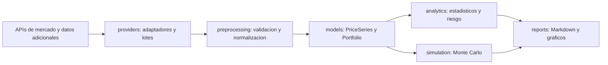

# Arquitectura prevista

Estructura para los bloques del taller. La capa de extraccion incluye 18 adaptadores
con consultas de muestra y contratos separados para series, precios, fundamentales
y documentos/registros. El analisis financiero y las carteras siguen pendientes.
El [catalogo de fuentes](data-sources.md) define las 18 fuentes previstas,
su segmentacion funcional y la configuracion de acceso.

## Siguientes implementaciones

1. Ampliar los contratos de extraccion existentes con modelos de analisis de series.
2. Ampliar las muestras de los adaptadores a consultas parametrizadas y paginadas,
   resolviendo los accesos pendientes de SIX y Nasdaq (ver `provider-check.md`).
3. Incorporar acciones, indices y datos adicionales, por ejemplo fundamentales.
4. Implementar validacion, limpieza, alineacion y descarga de N series.
5. Implementar Portfolio con ponderaciones y metodo de simulacion Monte Carlo.
6. Incorporar `.report()` y `.plots_report()` y diagramar las clases reales.
