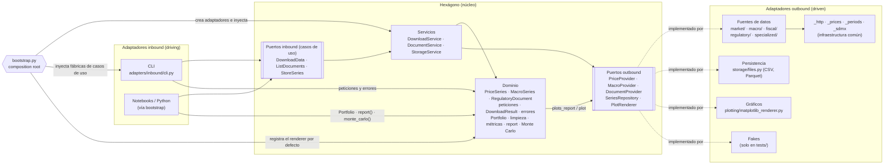
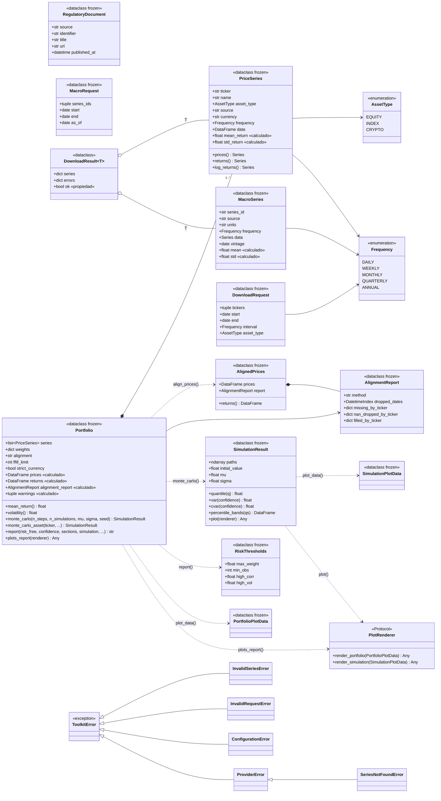
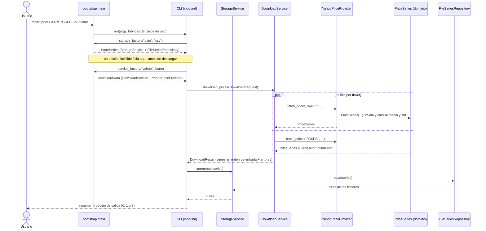

# Arquitectura del toolkit

El toolkit sigue una **arquitectura hexagonal (puertos y adaptadores)**, al estilo de
*Architecture Patterns with Python* (Percival & Gregory). Este documento explica qué hay
en cada capa, qué puede usar cada una y por qué.

## Por qué hexagonal

Las 15 fuentes integradas difieren en casi todo:

- **Transporte**: librería (`yfinance`), REST JSON, CSV SDMX y RSS.
- **Autenticación**: sin clave, clave en la URL, clave en cabecera o `User-Agent` obligatorio.
- **Errores**: HTTP 200 con el error en el cuerpo, 400 ambiguos, 412...
- **Fechas**: última sesión, fin de mes o inicio de periodo.
- **Mayúsculas**: unas rutas las distinguen y otras no.

Si esas diferencias llegaran al análisis, cada script de cartera o de Monte Carlo
tendría que conocerlas. La arquitectura las encierra en un adaptador por fuente; el
resto del sistema solo ve **un contrato común** (los modelos del dominio). Por eso:

- Añadir una fuente es **un módulo y una línea** en `bootstrap.py`; el núcleo no cambia.
- Cambiar de fuente no cambia la salida: siempre es la misma `PriceSeries` o `MacroSeries`.
- El núcleo se prueba **sin red**, con fakes; cada adaptador, con HTTP simulado.

Se descartaron dos alternativas: *scripts por fuente que devuelven `DataFrame`s* (cada
fuente impone su formato al análisis) y *capas clásicas datos → negocio → presentación*
(el negocio acaba dependiendo de tipos de `requests` o `yfinance`). En la hexagonal es
al revés: la infraestructura depende del núcleo.

## Diagrama

Las flechas continuas son dependencias de código y **siempre apuntan hacia el
dominio**. Las discontinuas indican qué adaptador cumple cada puerto: el adaptador no
hereda del puerto ni lo importa necesariamente; basta con que tenga los mismos métodos
(tipado estructural, PEP 544).

Los adaptadores inbound entran por dos sitios. Lo que necesita **I/O** (descargar,
listar documentos, guardar) pasa siempre por un puerto inbound, porque detrás hay un
adaptador outbound que cambiar. El **análisis** (`Portfolio`, `report()`, Monte Carlo,
métricas) se usa directamente desde el dominio: es cálculo puro en memoria, sin nada
que inyectar salvo el renderer de gráficos, y el enunciado lo pide como métodos de la
cartera. Un caso de uso que solo reenviara llamadas a `Portfolio` añadiría una capa sin
desacoplar nada. Lo que un adaptador inbound **nunca** importa son puertos outbound,
servicios ni otros adaptadores.

La flecha *Dominio → Puertos outbound* es la única excepción aparente: `Portfolio` y
`SimulationResult` delegan el dibujo en un `PlotRenderer`. El protocolo se **define en
el dominio** (`domain/plotting.py`) y `ports/outbound.py` solo lo reexporta, así que en
el código la dependencia sigue apuntando hacia dentro (ver
[Visualización y reportes](#visualización-y-reportes)).

## Diagrama de clases (UML)

### Modelo de dominio

Composición (`*--`): la cartera se compone de series de precios. Dependencia (`..>`):
crea o usa la otra clase. Los atributos marcados como *calculado* se rellenan en
`__post_init__`, al instanciar.

### Puertos, servicios y adaptadores

Realización (`..|>`): la clase cumple el protocolo de forma estructural (PEP 544), sin
heredar de él. Solo se muestra un adaptador representativo por tipo; la lista completa
está en [Adaptadores](#4-adaptadores-toolkitadapters).

```mermaid
classDiagram
    direction TB

    class DownloadData {
        <<Protocol · inbound>>
        +download_prices(DownloadRequest) DownloadResult
        +download_macro(MacroRequest) DownloadResult
    }
    class ListDocuments {
        <<Protocol · inbound>>
        +list_documents(DocumentRequest) list
    }
    class StoreSeries {
        <<Protocol · inbound>>
        +store(series) list
    }
    class PriceProvider {
        <<Protocol · outbound>>
        +name
        +fetch_prices(ticker, start, end, interval, asset_type) PriceSeries
    }
    class MacroProvider {
        <<Protocol · outbound>>
        +name
        +fetch_series(series_id, start, end, as_of) MacroSeries
    }
    class DocumentProvider {
        <<Protocol · outbound>>
        +fetch_documents(query, start, end, limit) list
    }
    class SeriesRepository {
        <<Protocol · outbound>>
        +save(series) list
    }
    class PlotRenderer {
        <<Protocol · outbound>>
        +render_portfolio(data) Any
        +render_simulation(data) Any
    }

    class DownloadService
    class DocumentService
    class StorageService
    class YahooPriceProvider
    class CoinGeckoPriceProvider
    class FredMacroProvider
    class SdmxMacroProvider
    class EcbMacroProvider
    class SecEdgarMacroProvider
    class CnmvDocumentProvider
    class FileSeriesRepository
    class MatplotlibPlotRenderer
    class CLI {
        <<adapter inbound>>
    }
    class bootstrap {
        <<composition root>>
        +build_download_service()
        +build_document_service()
        +build_storage_service()
        +build_plot_renderer()
        +configure_plotting()
    }

    DownloadService ..|> DownloadData
    DocumentService ..|> ListDocuments
    StorageService ..|> StoreSeries
    DownloadService --> PriceProvider
    DownloadService --> MacroProvider
    DocumentService --> DocumentProvider
    StorageService --> SeriesRepository

    YahooPriceProvider ..|> PriceProvider
    CoinGeckoPriceProvider ..|> PriceProvider
    FredMacroProvider ..|> MacroProvider
    SdmxMacroProvider ..|> MacroProvider
    SdmxMacroProvider <|-- EcbMacroProvider
    SecEdgarMacroProvider ..|> MacroProvider
    CnmvDocumentProvider ..|> DocumentProvider
    FileSeriesRepository ..|> SeriesRepository
    MatplotlibPlotRenderer ..|> PlotRenderer

    CLI --> DownloadData
    CLI --> ListDocuments
    CLI --> StoreSeries
    bootstrap ..> DownloadService : crea
    bootstrap ..> DocumentService : crea
    bootstrap ..> StorageService : crea
    bootstrap ..> MatplotlibPlotRenderer : crea
    bootstrap ..> CLI : inyecta fábricas
```

## Las capas, una a una

### 1. Dominio (`toolkit.domain`)

**Qué es:** el lenguaje común del toolkit. Lo que todas las demás capas producen o
consumen.

- **Series** (`models.py`): `PriceSeries` (OHLCV) y `MacroSeries` (univariante). Son
  dataclasses inmutables que **se validan al crearse** (`__post_init__`) y calculan sus
  estadísticos (media y desviación) en ese momento.
- **Documentos** (`documents.py`): `RegulatoryDocument`, para fuentes que no publican
  series sino textos (CNMV, ESMA).
- **Peticiones**: `DownloadRequest`, `MacroRequest` y `DocumentRequest`. Una petición
  inválida (`tickers=[]`, `start > end`...) falla antes de tocar la red.
- **Resultados y errores**: `DownloadResult[T]` y la jerarquía `ToolkitError`.
- **Limpieza** (`cleaning.py`): `align_prices` alinea los precios de varios activos en
  un calendario común y descarta NaNs, con un `AlignmentReport` de lo que ha quitado
  o rellenado (ver [Limpieza y alineación](#limpieza-y-alineación)).
- **Análisis** (`portfolio.py`, `simulation.py`, `metrics.py`): `Portfolio` (pesos,
  precios y retornos alineados, avisos de divisa), Monte Carlo (`simulate_gbm`,
  `SimulationResult`, con VaR y CVaR del valor final) y métricas puras (anualización, Sharpe, drawdown, VaR/CVaR).
- **Informes** (`report.py`, `plotting.py`): `Portfolio.report()` genera Markdown;
  `plots_report()` y `SimulationResult.plot()` preparan los datos de los gráficos y
  delegan el dibujo en un `PlotRenderer` inyectado.

**Puede usar:** stdlib, `pandas` y `numpy`. **Nada de I/O**: ni red, ni ficheros, ni
consola, ni librerías gráficas. El dominio no sabe que existen Yahoo, FRED, HTTP,
el disco o matplotlib.

### 2. Puertos (`toolkit.ports`)

**Qué son:** los contratos (`typing.Protocol` con `@runtime_checkable`) entre el núcleo
y el exterior. No contienen lógica.

- **Inbound** (`inbound.py`): lo que el núcleo **ofrece**, es decir, los casos de uso.
  - `DownloadData`: descarga en lote de precios y series macro.
  - `ListDocuments`: listado de documentos regulatorios.
  - `StoreSeries`: persistir series descargadas.
- **Outbound** (`outbound.py`): lo que el núcleo **necesita** del exterior.
  - `PriceProvider`, `MacroProvider`, `DocumentProvider`: fuentes de datos.
  - `SeriesRepository`: destino donde guardar series.
  - `PlotRenderer`: quien dibuja los gráficos. Se define en `domain/plotting.py`
    porque lo necesitan métodos del dominio, y aquí se reexporta.

**Puede usar:** solo el dominio.

### 3. Servicios (`toolkit.services`)

**Qué son:** las implementaciones de los casos de uso. Cumplen un puerto inbound y
trabajan con puertos outbound que reciben en el constructor.

| Servicio | Cumple | Usa | Qué garantiza |
|---|---|---|---|
| `DownloadService` | `DownloadData` | `PriceProvider`, `MacroProvider` | Descarga en paralelo, resultados en el orden de la petición; un fallo individual no aborta el lote (salvo `ConfigurationError`) |
| `DocumentService` | `ListDocuments` | `DocumentProvider` | Como mucho `limit` documentos, del más reciente al más antiguo, aunque la fuente no lo respete |
| `StorageService` | `StoreSeries` | `SeriesRepository` | Sin series no toca el destino; devuelve dónde quedó cada una |

Cada servicio comprueba con `isinstance` que lo que recibe cumple su puerto, así que
un error de cableado salta al construirlo, no a mitad de una descarga.

**Puede usar:** dominio y puertos. Ninguna librería de I/O.

### 4. Adaptadores (`toolkit.adapters`)

**Qué son:** la traducción entre el núcleo y el mundo real. Hay dos lados y **no se
mezclan**.

**Inbound (`adapters/inbound/`)**: quien *usa* el toolkit.

- `cli.py`: traduce argumentos de consola a peticiones del dominio, llama a los casos
  de uso e imprime el resultado. No conoce servicios, adaptadores, nombres de fuentes
  ni cómo se escriben los ficheros: recibe *fábricas* que devuelven objetos que cumplen
  `DownloadData`, `ListDocuments` o `StoreSeries`.
- **Puede usar:** dominio y **puertos inbound**. Nunca puertos outbound ni adaptadores
  outbound: si la CLI quiere guardar, lo pide a `StoreSeries`, no al repositorio.

**Outbound (`adapters/outbound/`)**: lo que el toolkit *usa*.

- **Fuentes de datos**, un módulo por fuente, agrupadas por tipo:

  | Carpeta | Adaptadores | Puerto |
  |---|---|---|
  | `market/` | `yahoo`, `alpha_vantage`, `twelve_data` | `PriceProvider` |
  | `macro/` | `fred`, `ecb`, `eurostat`, `bis`, `world_bank`, `banco_espana` | `MacroProvider` |
  | `fiscal/` | `us_treasury` | `MacroProvider` |
  | `regulatory/` | `sec_edgar` | `MacroProvider` |
  | `regulatory/` | `cnmv`, `esma` | `DocumentProvider` |
  | `specialized/` | `coingecko` | `PriceProvider` |
  | `specialized/` | `eia` | `MacroProvider` |

- **Persistencia** (`storage/files.py`): `FileSeriesRepository`, un CSV o Parquet por
  serie. Si se pide Parquet sin `pyarrow`, falla al construirse, antes de descargar.
- **Gráficos** (`plotting/matplotlib_renderer.py`): `MatplotlibPlotRenderer`, que
  cumple `PlotRenderer` y devuelve `Figure`s construidas con la API orientada a
  objetos (sin estado de `pyplot`: no abre ventanas ni bloquea).
- **Infraestructura común** (módulos privados `_*.py`, que no son adaptadores):
  - `_http`: reintentos, `Retry-After`, ocultación de claves y traducción HTTP → errores
    de dominio. Las fuentes que codifican el motivo en el cuerpo (FRED) aportan un
    `error_mapper`.
  - `_prices`: normalización OHLCV (con `adj_close` opcional).
  - `_periods`: formatos de periodo, frecuencias, recorte por fechas (`clip`) y
    refechado al inicio del periodo (`to_period_start`).
  - `_sdmx`: base SDMX-CSV. BCE, BIS y Eurostat son subclases de tres líneas.
- **Puede usar:** dominio, **puertos outbound**, librerías externas (`requests`,
  `yfinance`...) y los helpers `_*`. **Nunca otro adaptador**, aunque sea del mismo tipo.

Todos los adaptadores de fuentes traducen sus errores a la jerarquía del dominio, así
que ninguna excepción de `requests` o `yfinance` llega al núcleo (ver
[Criterio de errores](#criterio-de-errores)).

### 5. Composition root (`toolkit.bootstrap`)

**Qué es:** el único módulo que conoce las clases concretas y el único que lee el
entorno.

- Carga `.env` una sola vez por proceso.
- Registra las fuentes por nombre (`PRICE_PROVIDERS`, `MACRO_PROVIDERS`,
  `DOCUMENT_PROVIDERS`).
- Construye los casos de uso: `build_download_service`, `build_document_service` y
  `build_storage_service`. Es la API para usar el toolkit desde Python o un notebook.
- Construye el renderer de gráficos (`build_plot_renderer`, registro
  `PLOT_RENDERERS`) y lo registra como predeterminado con `configure_plotting()`.
  matplotlib se importa de forma perezosa, así que la CLI no lo carga.
- `main` inyecta esas fábricas, la lista de fuentes y las de por defecto en la CLI. Es
  el entry point del comando `toolkit`.

**Puede usar:** todo.

## Regla de dependencias

| Capa | Puede importar de `toolkit` | Librerías externas |
|---|---|---|
| `domain` | `domain` | `pandas`, `numpy` |
| `ports` | `domain` | `pandas`, `numpy` |
| `services` | `domain`, `ports` | `pandas`, `numpy` |
| `adapters.inbound` | `domain`, `ports.inbound` | cualquiera |
| `adapters.outbound` | `domain`, `ports.outbound`, helpers `outbound/_*` | cualquiera (`matplotlib` solo aquí) |
| `bootstrap` | todo | cualquiera |

La regla se comprueba en cada `pytest` con `tests/unit/test_architecture.py`. El test
recorre los imports de cada módulo con `ast` (incluidos los relativos) y falla si una
capa importa algo prohibido: `requests` en el dominio, `matplotlib` en un servicio, la
CLI importando un puerto outbound o `_http`, un adaptador importando otro... Tiene sus
propios autotests con violaciones sintéticas, para asegurar que las detecta.

También comprueba que `src/` no contiene código de test (ficheros `test_*`/`fake*`/
`conftest` ni imports de `pytest`, `unittest` o `responses`). Los fakes viven en
`tests/fakes.py`.

### Cómo se prueba cada capa

- **Dominio y servicios**: tests unitarios con los fakes de `tests/fakes.py`, que cumplen
  los puertos outbound. Gracias a la inversión de dependencias, el núcleo se prueba sin
  ningún adaptador.
- **Adaptadores**: tests unitarios con HTTP simulado (`responses`) para cada caso
  límite, y tests de integración con **respuestas reales grabadas**
  (`tests/resources/<fuente>/`), que recorren `bootstrap` → servicio → adaptador →
  `HttpClient` → dominio.
- **De extremo a extremo**: `bootstrap.main` con argumentos de consola, ficheros reales
  en un directorio temporal y las mismas grabaciones.

Ningún test accede a la red: `tests/conftest.py` lo bloquea, así que si a un test le
falta un mock falla con un mensaje claro en lugar de llamar a la API real.

Sobre las grabaciones de integración:

- Cada fuente tiene una respuesta correcta y otra de error, tal como las devolvió la API
  (un 404, un 400 con XML, un HTTP 200 con el error en el cuerpo, el límite de peticiones
  de Alpha Vantage...).
- Los valores esperados se leen del cuerpo grabado, no del adaptador.
- El mock es estricto: si un adaptador cambia la URL o un parámetro, el test falla, igual
  que fallaría contra la API real.
- Las credenciales aparecen como `<NOMBRE_DE_LA_VARIABLE>` y las respuestas muy grandes
  están recortadas sin cambiar su estructura. Un test comprueba que ninguna grabación
  contiene una clave y que todas están en uso.

## Flujo de una petición

`toolkit prices AAPL ^GSPC --start 2020-01-01 --out data/`:

1. **`bootstrap.main`** inyecta las fábricas en la CLI, que parsea los argumentos.
2. Como hay `--out`, la CLI pide a la fábrica de almacenamiento un `StoreSeries`:
   `build_storage_service(Path("data"), "csv")` →
   `StorageService(FileSeriesRepository(...))`. Si el destino no es válido (p. ej.
   Parquet sin `pyarrow`), falla aquí, **antes de descargar**.
3. La CLI pide el caso de uso de descarga: `build_download_service("yahoo", None)` →
   `DownloadService(YahooPriceProvider())`. Construye un `DownloadRequest`, que se
   valida al crearse, y llama a `DownloadData.download_prices(request)`.
4. **`DownloadService`** lanza una llamada `PriceProvider.fetch_prices` por ticker en un
   `ThreadPoolExecutor`.
5. **`YahooPriceProvider`** llama a `yfinance` y normaliza el `DataFrame` (columnas en
   minúsculas, tz-naive, ordenado, sin duplicados). Construye la `PriceSeries`, que
   valida su esquema y calcula `mean_return`/`std_return`. Los errores de `yfinance` se
   traducen a `SeriesNotFoundError`/`ProviderError`.
6. El servicio recoge los resultados **en el orden de entrada**. Un fallo individual se
   guarda en `DownloadResult.errors`.
7. La CLI imprime el resumen y llama a `StoreSeries.store(result.series)`, que escribe
   `data/AAPL.csv` y `data/_GSPC.csv`.
8. Código de salida: 0 si hay al menos una serie OK, 1 si fallan todas y 2 ante errores
   de uso o configuración.

## Modelo de datos (el contrato)

- **`PriceSeries`**: `ticker`, `name`, `asset_type`, `source`, `currency`, `frequency` y
  `data`. `data` es un `DataFrame` con `DatetimeIndex` ordenado, único y tz-naive, y con
  las columnas `open, high, low, close, [adj_close], volume`.
  - Se calculan automáticamente `mean_return` y `std_return`: media y desviación típica
    muestral de los retornos simples por periodo, **sin anualizar**, sobre `adj_close`
    (o `close` si no existe).
  - Propiedades: `returns`, `log_returns`, `prices`, `start`, `end`, `n_obs`.
- **`MacroSeries`**: `series_id`, `name`, `source`, `units`, `frequency`, `data` (una
  `pd.Series` float con `NaN` para los huecos) y `vintage`. Calcula `mean` y `std`.
- **`RegulatoryDocument`**: `source`, `identifier`, `title`, `url`, `published_at`
  (UTC, tz-naive) y, opcionales, `issuer`, `category` y `summary`.
- **Peticiones** (`DownloadRequest`, `MacroRequest`, `DocumentRequest`): inmutables y
  validadas al crearse; los ids se guardan como `tuple`, sin cambiar mayúsculas (cada
  API las trata a su manera).
- **`DownloadResult[T]`**: `series` (en el orden de la petición) y `errors`, con las
  propiedades `ok`, `n_success`, `n_failed` y `all_failed`.

### Criterio de errores

`ToolkitError` es la base de `InvalidSeriesError`, `InvalidDocumentError`,
`InvalidRequestError`, `ConfigurationError` y `ProviderError`; de este último deriva
`SeriesNotFoundError`. Todos los adaptadores siguen el mismo criterio:

- `InvalidRequestError`: la petición no tiene sentido para la fuente (id mal formado,
  `as_of` o frecuencia no soportados, formato de fichero desconocido).
- `ConfigurationError`: falta o se rechaza una credencial (401/403), o falta una
  dependencia opcional (`pyarrow`). **Aborta el lote**, porque afecta a todas las series.
- `SeriesNotFoundError`: el id no existe o no hay datos en el rango.
- `ProviderError`: red, límites de la API, formato inesperado o fallo de escritura.

### Convención de fechas

Toda serie diaria se fecha con su sesión, y toda observación semanal o de menor
frecuencia con el **inicio** de su periodo (lunes, día 1 del mes...), sea cual sea la
fuente. Las APIs no coinciden (Alpha Vantage usa la última sesión de la semana; el
Tesoro, el último día del mes), así que los adaptadores refechan con
`_periods.to_period_start`. Sin esto, las series de varias fuentes no se alinean en
una cartera. Excepción documentada: los fundamentales de SEC EDGAR usan la fecha de
cierre, porque los ejercicios fiscales no siguen el calendario.

### FRED vs ALFRED

Sin `as_of`, FRED devuelve la **última revisión** de cada dato. Con `as_of`, el
adaptador envía `realtime_start = realtime_end = as_of` y obtiene los datos **tal como
se conocían ese día** (vintage). Así se evita el *look-ahead bias* en backtests, porque
muchas series macro (PIB, IPC, empleo) se revisan después de publicarse.

### Limpieza y alineación

Los activos de una cartera no comparten calendario: una cripto cotiza 24/7 y cada bolsa
tiene sus festivos. `Portfolio` **alinea primero los precios** (`align_prices`) y solo
después calcula los retornos. Si se hiciera al revés (retornos de cada serie y luego
cruce por fecha), el retorno de un mismo día abarcaría intervalos distintos en cada
activo (el lunes de AAPL es viernes→lunes; el de BTC, domingo→lunes) y el movimiento de
las fechas descartadas se perdería.

| Método | Qué fechas quedan | Coste |
|---|---|---|
| `inner` (por defecto) | las comunes a todos los activos | se pierden fechas, pero cada retorno es comparable |
| `ffill` | la unión, rellenando como mucho `ffill_limit` periodos | cada relleno es un retorno 0 artificial: **sesga a la baja** volatilidad y correlación |

`ffill` nunca rellena hacia atrás (sería *look-ahead*) ni más allá del último precio de
cada serie. Los precios no finitos se descartan y se cuentan; un precio `<= 0` es un
error. Todo queda en `Portfolio.alignment_report`, y `report()` lo muestra en el
diagnóstico y avisa si se ha descartado más del 10 % de las fechas.

## Extender el sistema

- **Nueva fuente de un tipo existente** (otra API de precios o de series): un módulo en
  `adapters/outbound/<tipo>/` que cumpla `PriceProvider` o `MacroProvider`, y una línea
  en el registro de `bootstrap.py`. Debe respetar el criterio de errores y la
  convención de fechas. Así se integraron las 15 fuentes. SEC EDGAR entra como
  `MacroProvider` porque un concepto contable es una serie univariante y `as_of` le da
  sentido *point-in-time*.
- **Nuevo tipo de dato** (como los documentos regulatorios): no es una serie temporal,
  así que forzarlo en `MacroSeries` rompería el contrato. Requiere un modelo, una
  petición, un puerto outbound y un caso de uso (puerto inbound + servicio). Es una
  **extensión** del núcleo: ningún modelo, puerto ni servicio existente cambia.
- **Nuevo destino de persistencia** (base de datos, S3...): un adaptador en
  `adapters/outbound/storage/` que cumpla `SeriesRepository`, y cablearlo en
  `build_storage_service`. La CLI y los notebooks no cambian.
- **Nuevo punto de entrada** (API REST, notebook): un adaptador inbound que reciba los
  casos de uso desde `bootstrap` y use solo puertos inbound y dominio, nunca puertos
  outbound ni adaptadores.
- **Nuevo motor de gráficos** (plotly, bokeh...): un adaptador en
  `adapters/outbound/plotting/` que cumpla `PlotRenderer` y una línea en
  `PLOT_RENDERERS`. `Portfolio` y `SimulationResult` no cambian.

## Visualización y reportes

El enunciado pide `report()`, `plots_report()` y la visualización del Monte Carlo como
**métodos de la cartera**, pero el dominio no puede depender de una librería gráfica.
Se resuelve con inversión de dependencias:

- **`report()`** es construcción de texto: vive entero en el dominio (`report.py`),
  sin dependencias nuevas (las tablas Markdown se escriben a mano).
- **`plots_report()` y `SimulationResult.plot()`** calculan en el dominio *qué* hay
  que mostrar (`PortfolioPlotData`, `SimulationPlotData`: solo pandas y numpy) y
  delegan el *cómo* en un `PlotRenderer`.
- El protocolo `PlotRenderer` se define en `domain/plotting.py` (el dominio no puede
  importar `ports`) y `ports/outbound.py` lo reexporta. `MatplotlibPlotRenderer` lo
  implementa en `adapters/outbound/plotting/`.
- El renderer se pasa en cada llamada (`plots_report(renderer)`) o se registra una
  vez con `bootstrap.configure_plotting()`. Ese registro es el único estado global del
  dominio; los tests lo reinician en cada caso (`tests/conftest.py`).

Así el test de arquitectura sigue prohibiendo `matplotlib` en el dominio, y los
gráficos se prueban dos veces: la delegación con un renderer fake y el dibujo real
con el backend `Agg`.
