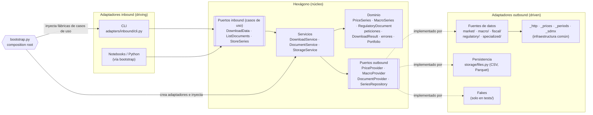

# Arquitectura del toolkit

El toolkit sigue una **arquitectura hexagonal (puertos y adaptadores)**, al estilo de
*Architecture Patterns with Python* (Percival & Gregory). Este documento explica qué hay
en cada capa, qué puede usar cada una y por qué.

## Por qué hexagonal

Las 15 fuentes integradas difieren en casi todo:

- **Transporte**: librería (`yfinance`), REST JSON, CSV SDMX y RSS.
- **Autenticación**: sin clave, clave en la URL, clave en cabecera o `User-Agent` obligatorio.
- **Errores**: HTTP 200 con el error en el cuerpo, 400 ambiguos, 412...
- **Fechas**: última sesión, fin de mes o inicio de periodo.
- **Mayúsculas**: unas rutas las distinguen y otras no.

Si esas diferencias llegaran al análisis, cada script de cartera o de Monte Carlo
tendría que conocerlas. La arquitectura las encierra en un adaptador por fuente; el
resto del sistema solo ve **un contrato común** (los modelos del dominio). Por eso:

- Añadir una fuente es **un módulo y una línea** en `bootstrap.py`; el núcleo no cambia.
- Cambiar de fuente no cambia la salida: siempre es la misma `PriceSeries` o `MacroSeries`.
- El núcleo se prueba **sin red**, con fakes; cada adaptador, con HTTP simulado.

Se descartaron dos alternativas: *scripts por fuente que devuelven `DataFrame`s* (cada
fuente impone su formato al análisis) y *capas clásicas datos → negocio → presentación*
(el negocio acaba dependiendo de tipos de `requests` o `yfinance`). En la hexagonal es
al revés: la infraestructura depende del núcleo.

## Diagrama

Las flechas continuas son dependencias de código y **siempre apuntan hacia el
dominio**. Las discontinuas indican qué adaptador cumple cada puerto: el adaptador no
hereda del puerto ni lo importa necesariamente; basta con que tenga los mismos métodos
(tipado estructural, PEP 544).

## Las capas, una a una

### 1. Dominio (`toolkit.domain`)

**Qué es:** el lenguaje común del toolkit. Lo que todas las demás capas producen o
consumen.

- **Series** (`models.py`): `PriceSeries` (OHLCV) y `MacroSeries` (univariante). Son
  dataclasses inmutables que **se validan al crearse** (`__post_init__`) y calculan sus
  estadísticos (media y desviación) en ese momento.
- **Documentos** (`documents.py`): `RegulatoryDocument`, para fuentes que no publican
  series sino textos (CNMV, ESMA).
- **Peticiones**: `DownloadRequest`, `MacroRequest` y `DocumentRequest`. Una petición
  inválida (`tickers=[]`, `start > end`...) falla antes de tocar la red.
- **Resultados y errores**: `DownloadResult[T]` y la jerarquía `ToolkitError`.
- **Análisis** (`portfolio.py`, `simulation.py`): `Portfolio` (pesos, retornos alineados,
  volatilidad) y Monte Carlo (`simulate_gbm`).

**Puede usar:** stdlib, `pandas` y `numpy`. **Nada de I/O**: ni red, ni ficheros, ni
consola, ni gráficos. El dominio no sabe que existen Yahoo, FRED, HTTP o el disco.

### 2. Puertos (`toolkit.ports`)

**Qué son:** los contratos (`typing.Protocol` con `@runtime_checkable`) entre el núcleo
y el exterior. No contienen lógica.

- **Inbound** (`inbound.py`): lo que el núcleo **ofrece**, es decir, los casos de uso.
  - `DownloadData`: descarga en lote de precios y series macro.
  - `ListDocuments`: listado de documentos regulatorios.
  - `StoreSeries`: persistir series descargadas.
- **Outbound** (`outbound.py`): lo que el núcleo **necesita** del exterior.
  - `PriceProvider`, `MacroProvider`, `DocumentProvider`: fuentes de datos.
  - `SeriesRepository`: destino donde guardar series.

**Puede usar:** solo el dominio.

### 3. Servicios (`toolkit.services`)

**Qué son:** las implementaciones de los casos de uso. Cumplen un puerto inbound y
trabajan con puertos outbound que reciben en el constructor.

| Servicio | Cumple | Usa | Qué garantiza |
|---|---|---|---|
| `DownloadService` | `DownloadData` | `PriceProvider`, `MacroProvider` | Descarga en paralelo, resultados en el orden de la petición; un fallo individual no aborta el lote (salvo `ConfigurationError`) |
| `DocumentService` | `ListDocuments` | `DocumentProvider` | Como mucho `limit` documentos, del más reciente al más antiguo, aunque la fuente no lo respete |
| `StorageService` | `StoreSeries` | `SeriesRepository` | Sin series no toca el destino; devuelve dónde quedó cada una |

Cada servicio comprueba con `isinstance` que lo que recibe cumple su puerto, así que
un error de cableado salta al construirlo, no a mitad de una descarga.

**Puede usar:** dominio y puertos. Ninguna librería de I/O.

### 4. Adaptadores (`toolkit.adapters`)

**Qué son:** la traducción entre el núcleo y el mundo real. Hay dos lados y **no se
mezclan**.

**Inbound (`adapters/inbound/`)**: quien *usa* el toolkit.

- `cli.py`: traduce argumentos de consola a peticiones del dominio, llama a los casos
  de uso e imprime el resultado. No conoce servicios, adaptadores, nombres de fuentes
  ni cómo se escriben los ficheros: recibe *fábricas* que devuelven objetos que cumplen
  `DownloadData`, `ListDocuments` o `StoreSeries`.
- **Puede usar:** dominio y **puertos inbound**. Nunca puertos outbound ni adaptadores
  outbound: si la CLI quiere guardar, lo pide a `StoreSeries`, no al repositorio.

**Outbound (`adapters/outbound/`)**: lo que el toolkit *usa*.

- **Fuentes de datos**, un módulo por fuente, agrupadas por tipo:

  | Carpeta | Adaptadores | Puerto |
  |---|---|---|
  | `market/` | `yahoo`, `alpha_vantage`, `twelve_data` | `PriceProvider` |
  | `macro/` | `fred`, `ecb`, `eurostat`, `bis`, `world_bank`, `banco_espana` | `MacroProvider` |
  | `fiscal/` | `us_treasury` | `MacroProvider` |
  | `regulatory/` | `sec_edgar` | `MacroProvider` |
  | `regulatory/` | `cnmv`, `esma` | `DocumentProvider` |
  | `specialized/` | `coingecko` | `PriceProvider` |
  | `specialized/` | `eia` | `MacroProvider` |

- **Persistencia** (`storage/files.py`): `FileSeriesRepository`, un CSV o Parquet por
  serie. Si se pide Parquet sin `pyarrow`, falla al construirse, antes de descargar.
- **Infraestructura común** (módulos privados `_*.py`, que no son adaptadores):
  - `_http`: reintentos, `Retry-After`, ocultación de claves y traducción HTTP → errores
    de dominio. Las fuentes que codifican el motivo en el cuerpo (FRED) aportan un
    `error_mapper`.
  - `_prices`: normalización OHLCV (con `adj_close` opcional).
  - `_periods`: formatos de periodo, frecuencias, recorte por fechas (`clip`) y
    refechado al inicio del periodo (`to_period_start`).
  - `_sdmx`: base SDMX-CSV. BCE, BIS y Eurostat son subclases de tres líneas.
- **Puede usar:** dominio, **puertos outbound**, librerías externas (`requests`,
  `yfinance`...) y los helpers `_*`. **Nunca otro adaptador**, aunque sea del mismo tipo.

Todos los adaptadores de fuentes traducen sus errores a la jerarquía del dominio, así
que ninguna excepción de `requests` o `yfinance` llega al núcleo (ver
[Criterio de errores](#criterio-de-errores)).

### 5. Composition root (`toolkit.bootstrap`)

**Qué es:** el único módulo que conoce las clases concretas y el único que lee el
entorno.

- Carga `.env` una sola vez por proceso.
- Registra las fuentes por nombre (`PRICE_PROVIDERS`, `MACRO_PROVIDERS`,
  `DOCUMENT_PROVIDERS`).
- Construye los casos de uso: `build_download_service`, `build_document_service` y
  `build_storage_service`. Es la API para usar el toolkit desde Python o un notebook.
- `main` inyecta esas fábricas, la lista de fuentes y las de por defecto en la CLI. Es
  el entry point del comando `toolkit`.

**Puede usar:** todo.

## Regla de dependencias

| Capa | Puede importar de `toolkit` | Librerías externas |
|---|---|---|
| `domain` | `domain` | `pandas`, `numpy` |
| `ports` | `domain` | `pandas`, `numpy` |
| `services` | `domain`, `ports` | `pandas`, `numpy` |
| `adapters.inbound` | `domain`, `ports.inbound` | cualquiera |
| `adapters.outbound` | `domain`, `ports.outbound`, helpers `outbound/_*` | cualquiera |
| `bootstrap` | todo | cualquiera |

La regla se comprueba en cada `pytest` con `tests/unit/test_architecture.py`. El test
recorre los imports de cada módulo con `ast` (incluidos los relativos) y falla si una
capa importa algo prohibido: `requests` en el dominio, `matplotlib` en un servicio, la
CLI importando un puerto outbound o `_http`, un adaptador importando otro... Tiene sus
propios autotests con violaciones sintéticas, para asegurar que las detecta.

También comprueba que `src/` no contiene código de test (ficheros `test_*`/`fake*`/
`conftest` ni imports de `pytest`, `unittest` o `responses`). Los fakes viven en
`tests/fakes.py`.

## Flujo de una petición

`toolkit prices AAPL ^GSPC --start 2020-01-01 --out data/`:

1. **`bootstrap.main`** inyecta las fábricas en la CLI, que parsea los argumentos.
2. Como hay `--out`, la CLI pide a la fábrica de almacenamiento un `StoreSeries`:
   `build_storage_service(Path("data"), "csv")` →
   `StorageService(FileSeriesRepository(...))`. Si el destino no es válido (p. ej.
   Parquet sin `pyarrow`), falla aquí, **antes de descargar**.
3. La CLI pide el caso de uso de descarga: `build_download_service("yahoo", None)` →
   `DownloadService(YahooPriceProvider())`. Construye un `DownloadRequest`, que se
   valida al crearse, y llama a `DownloadData.download_prices(request)`.
4. **`DownloadService`** lanza una llamada `PriceProvider.fetch_prices` por ticker en un
   `ThreadPoolExecutor`.
5. **`YahooPriceProvider`** llama a `yfinance` y normaliza el `DataFrame` (columnas en
   minúsculas, tz-naive, ordenado, sin duplicados). Construye la `PriceSeries`, que
   valida su esquema y calcula `mean_return`/`std_return`. Los errores de `yfinance` se
   traducen a `SeriesNotFoundError`/`ProviderError`.
6. El servicio recoge los resultados **en el orden de entrada**. Un fallo individual se
   guarda en `DownloadResult.errors`.
7. La CLI imprime el resumen y llama a `StoreSeries.store(result.series)`, que escribe
   `data/AAPL.csv` y `data/_GSPC.csv`.
8. Código de salida: 0 si hay al menos una serie OK, 1 si fallan todas y 2 ante errores
   de uso o configuración.

## Modelo de datos (el contrato)

- **`PriceSeries`**: `ticker`, `name`, `asset_type`, `source`, `currency`, `frequency` y
  `data`. `data` es un `DataFrame` con `DatetimeIndex` ordenado, único y tz-naive, y con
  las columnas `open, high, low, close, [adj_close], volume`.
  - Se calculan automáticamente `mean_return` y `std_return`: media y desviación típica
    muestral de los retornos simples por periodo, **sin anualizar**, sobre `adj_close`
    (o `close` si no existe).
  - Propiedades: `returns`, `log_returns`, `prices`, `start`, `end`, `n_obs`.
- **`MacroSeries`**: `series_id`, `name`, `source`, `units`, `frequency`, `data` (una
  `pd.Series` float con `NaN` para los huecos) y `vintage`. Calcula `mean` y `std`.
- **`RegulatoryDocument`**: `source`, `identifier`, `title`, `url`, `published_at`
  (UTC, tz-naive) y, opcionales, `issuer`, `category` y `summary`.
- **Peticiones** (`DownloadRequest`, `MacroRequest`, `DocumentRequest`): inmutables y
  validadas al crearse; los ids se guardan como `tuple`, sin cambiar mayúsculas (cada
  API las trata a su manera).
- **`DownloadResult[T]`**: `series` (en el orden de la petición) y `errors`, con las
  propiedades `ok`, `n_success`, `n_failed` y `all_failed`.

### Criterio de errores

`ToolkitError` es la base de `InvalidSeriesError`, `InvalidDocumentError`,
`InvalidRequestError`, `ConfigurationError` y `ProviderError`; de este último deriva
`SeriesNotFoundError`. Todos los adaptadores siguen el mismo criterio:

- `InvalidRequestError`: la petición no tiene sentido para la fuente (id mal formado,
  `as_of` o frecuencia no soportados, formato de fichero desconocido).
- `ConfigurationError`: falta o se rechaza una credencial (401/403), o falta una
  dependencia opcional (`pyarrow`). **Aborta el lote**, porque afecta a todas las series.
- `SeriesNotFoundError`: el id no existe o no hay datos en el rango.
- `ProviderError`: red, límites de la API, formato inesperado o fallo de escritura.

### Convención de fechas

Toda serie diaria se fecha con su sesión, y toda observación semanal o de menor
frecuencia con el **inicio** de su periodo (lunes, día 1 del mes...), sea cual sea la
fuente. Las APIs no coinciden (Alpha Vantage usa la última sesión de la semana; el
Tesoro, el último día del mes), así que los adaptadores refechan con
`_periods.to_period_start`. Sin esto, las series de varias fuentes no se alinean en
una cartera. Excepción documentada: los fundamentales de SEC EDGAR usan la fecha de
cierre, porque los ejercicios fiscales no siguen el calendario.

### FRED vs ALFRED

Sin `as_of`, FRED devuelve la **última revisión** de cada dato. Con `as_of`, el
adaptador envía `realtime_start = realtime_end = as_of` y obtiene los datos **tal como
se conocían ese día** (vintage). Así se evita el *look-ahead bias* en backtests, porque
muchas series macro (PIB, IPC, empleo) se revisan después de publicarse.

## Extender el sistema

- **Nueva fuente de un tipo existente** (otra API de precios o de series): un módulo en
  `adapters/outbound/<tipo>/` que cumpla `PriceProvider` o `MacroProvider`, y una línea
  en el registro de `bootstrap.py`. Debe respetar el criterio de errores y la
  convención de fechas. Así se integraron las 15 fuentes. SEC EDGAR entra como
  `MacroProvider` porque un concepto contable es una serie univariante y `as_of` le da
  sentido *point-in-time*.
- **Nuevo tipo de dato** (como los documentos regulatorios): no es una serie temporal,
  así que forzarlo en `MacroSeries` rompería el contrato. Requiere un modelo, una
  petición, un puerto outbound y un caso de uso (puerto inbound + servicio). Es una
  **extensión** del núcleo: ningún modelo, puerto ni servicio existente cambia.
- **Nuevo destino de persistencia** (base de datos, S3...): un adaptador en
  `adapters/outbound/storage/` que cumpla `SeriesRepository`, y cablearlo en
  `build_storage_service`. La CLI y los notebooks no cambian.
- **Nuevo punto de entrada** (API REST, notebook): un adaptador inbound que use solo los
  puertos inbound y reciba los casos de uso desde `bootstrap`.
- **Visualización y reportes** (`plots_report`...): el dominio calcula, no dibuja. Los
  gráficos van en un adaptador (o en el propio notebook) que consuma los objetos del
  dominio; así el núcleo sigue sin depender de `matplotlib`.
