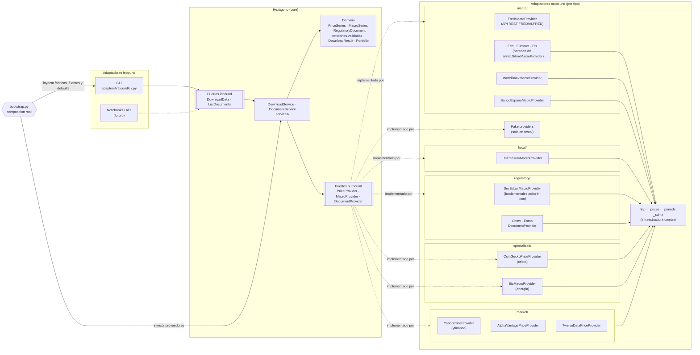

# Arquitectura del toolkit

El toolkit sigue una **arquitectura hexagonal (puertos y adaptadores)**, tal como se
describe en *Architecture Patterns with Python* (Percival & Gregory). La decisión y sus
alternativas están en [ADR 0001](adr/0001-arquitectura-hexagonal.md).

## Diagrama

## Capas

| Capa | Paquete | Responsabilidad | Puede importar |
|------|---------|-----------------|----------------|
| Dominio | `toolkit.domain` | Modelos (`PriceSeries`, `MacroSeries`, `RegulatoryDocument`), peticiones (`DownloadRequest`, `MacroRequest`, `DocumentRequest`), `DownloadResult`, errores, `Portfolio`. Todas las dataclasses se validan en `__post_init__`. | stdlib, `pandas`, `numpy`, `matplotlib` (solo visualización: `plots_report()` y Monte Carlo, requeridos como métodos de `Portfolio` por el enunciado) |
| Puertos | `toolkit.ports` | Contratos (`Protocol`): `DownloadData` y `ListDocuments` (inbound); `PriceProvider`, `MacroProvider` y `DocumentProvider` (outbound). | `domain` |
| Servicios | `toolkit.services` | Casos de uso: `DownloadService` (descarga en lote, paralelismo, tolerancia a fallos) y `DocumentService` (orden y límite garantizados). | `domain`, `ports` |
| Adaptadores | `toolkit.adapters` | Traducción con el exterior: CLI (inbound); fuentes de datos (outbound) agrupadas por tipo en `market/`, `macro/`, `fiscal/`, `regulatory/` y `specialized/`. Los fakes viven en `tests/`. | `domain`, `ports`, librerías externas y helpers privados `_*` (p. ej. `_http`); **nunca otro adaptador** |
| Composition root | `toolkit.bootstrap` | Carga `.env`, elige proveedores por nombre y los inyecta, junto con las fuentes por defecto de la CLI. Punto de entrada `toolkit`. | todo |

### Regla de dependencias

Las dependencias solo apuntan **hacia dentro**: adaptadores → puertos → dominio.
El dominio no sabe que existen Yahoo, FRED, HTTP ni la consola.

La regla se comprueba automáticamente en `tests/unit/test_architecture.py`, que recorre
los imports de cada módulo con `ast` y falla si alguna capa importa algo prohibido
(incluidos imports relativos y `yfinance`/`requests` en capas internas). También
comprueba que `src/` no contiene código de test: ni ficheros `test_*`/`fake*`/`conftest`
ni imports de `pytest`, `unittest` o `responses`.

La CLI tampoco importa `bootstrap`, servicios ni puertos outbound, y no conoce nombres
de fuentes ni de librerías. Recibe *fábricas* que devuelven objetos que cumplen
`DownloadData` o `ListDocuments`, la lista de fuentes y las de por defecto; es
`bootstrap.main` quien se lo inyecta. Por eso el entry point del paquete es
`toolkit.bootstrap:main`.

## Flujo de una petición

`toolkit prices AAPL ^GSPC --start 2020-01-01`:

1. **`bootstrap.main`** carga `.env`, y la CLI (`cli.run`) parsea los argumentos.
2. La CLI llama a la fábrica inyectada →
   `build_download_service("yahoo", None)` → `DownloadService(YahooPriceProvider())`.
3. La CLI construye un `DownloadRequest` (dominio), que se valida al crearse: lista no
   vacía, `start <= end`, ids limpios y sin duplicados (sin cambiar mayúsculas, porque
   cada API las trata a su manera). Después llama a
   `DownloadData.download_prices(request)` (puerto inbound).
4. **`DownloadService`** lanza N llamadas `PriceProvider.fetch_prices` en un
   `ThreadPoolExecutor`.
5. **`YahooPriceProvider`** llama a `yfinance` con `auto_adjust=False` y normaliza el
   `DataFrame`: columnas en minúsculas, tz-naive, ordenado y sin duplicados. Construye
   la `PriceSeries`, que valida su esquema y calcula `mean_return`/`std_return` en
   `__post_init__`. Los errores de `yfinance` se traducen a
   `SeriesNotFoundError`/`ProviderError`.
6. El servicio recoge los resultados **en el orden de entrada**. Un fallo individual se
   guarda en `DownloadResult.errors` y no aborta el lote; solo `ConfigurationError` lo
   detiene, porque afecta a todas las series.
7. La CLI imprime el resumen, guarda CSV/Parquet si se indicó `--out` y devuelve el
   código de salida: 0 si hay al menos una serie OK, 1 si fallan todas y 2 ante errores
   de uso o configuración.

## Modelo de datos (el contrato)

- **`PriceSeries`**: `ticker`, `name`, `asset_type`, `source`, `currency`, `frequency` y
  `data`. `data` es un `DataFrame` con `DatetimeIndex` ordenado, único y tz-naive, y con
  las columnas `open, high, low, close, [adj_close], volume`.
  - Se calculan automáticamente `mean_return` y `std_return`: media y desviación típica
    muestral de los retornos simples por periodo, **sin anualizar**, sobre `adj_close`
    (o `close` si no existe).
  - Propiedades: `returns`, `log_returns`, `prices`, `start`, `end`, `n_obs`.
- **`MacroSeries`**: `series_id`, `name`, `source`, `units`, `frequency`, `data` (una
  `pd.Series` float con `NaN` para los huecos) y `vintage`. Calcula `mean` y `std`.
- **`RegulatoryDocument`**: `source`, `identifier`, `title`, `url`, `published_at`
  (UTC, tz-naive) y, opcionales, `issuer`, `category` y `summary`.
- **Peticiones** (`DownloadRequest`, `MacroRequest`, `DocumentRequest`): inmutables y
  validadas al crearse; los ids se guardan como `tuple`.
- **`DownloadResult[T]`**: `series` (en el orden de la petición) y `errors`, con las
  propiedades `ok`, `n_success`, `n_failed` y `all_failed`.
- **Errores**: `ToolkitError` es la base de `InvalidSeriesError`, `InvalidDocumentError`,
  `InvalidRequestError`, `ConfigurationError` y `ProviderError`; de este último deriva
  `SeriesNotFoundError`. Criterio común a todos los adaptadores:
  - `InvalidRequestError`: la petición no tiene sentido para la fuente (id mal formado,
    `as_of` o frecuencia no soportados).
  - `ConfigurationError`: falta o se rechaza una credencial (401/403); aborta el lote.
  - `SeriesNotFoundError`: el id no existe o no hay datos en el rango.
  - `ProviderError`: red, límites de la API o formato inesperado.

### Convención de fechas

Toda serie diaria se fecha con su sesión, y toda observación semanal o de menor
frecuencia con el **inicio** de su periodo (lunes, día 1 del mes...), sea cual sea la
fuente. Las APIs no coinciden (Alpha Vantage usa la última sesión de la semana; el
Tesoro, el último día del mes), así que los adaptadores refechan con
`_periods.to_period_start`. Sin esto, las series de varias fuentes no se alinean en
una cartera. Excepción documentada: los fundamentales de SEC EDGAR usan la fecha de
cierre, porque los ejercicios fiscales no siguen el calendario.

## ¿Nueva fuente o nuevo tipo de dato?

- **Nueva fuente** de un tipo existente (otra API de precios o de series): solo hace
  falta un adaptador y una línea en `bootstrap`. Así se añadieron todas las fuentes
  market, macro, fiscal y specialized, y también SEC EDGAR, porque un concepto contable
  es una serie univariante y `as_of` le da sentido *point-in-time*.
- **Nuevo tipo de dato** (documentos regulatorios): no es una serie temporal, así que
  forzarlo en `MacroSeries` rompería el contrato (media y desviación de un texto).
  Requiere un modelo (`RegulatoryDocument`), una petición (`DocumentRequest`), un
  puerto outbound (`DocumentProvider`) y, para que la CLI no lo use directamente, un
  caso de uso (`ListDocuments` + `DocumentService`).
  Es una extensión del núcleo, no una modificación: ningún modelo, puerto ni servicio
  existente cambia.

## Infraestructura común de adaptadores

Los módulos privados `adapters/outbound/_*.py` no son adaptadores: no implementan
puertos ni hablan con una fuente concreta. Agrupan lo que, si no, se duplicaría en cada
adaptador:

- `_http`: reintentos, `Retry-After`, ocultación de claves y traducción HTTP → errores de
  dominio. Las fuentes que codifican el motivo en el cuerpo (FRED) aportan un
  `error_mapper`. Todas las fuentes REST lo usan.
- `_prices`: normalización OHLCV (con `adj_close` opcional), común a Yahoo y a las REST.
- `_periods`: formatos de periodo, frecuencias, recorte por fechas (`clip`) y
  refechado al inicio del periodo (`to_period_start`).
- `_sdmx`: base SDMX-CSV. BCE, BIS y Eurostat son subclases de tres líneas.

El test de arquitectura permite importarlos, pero sigue prohibiendo que un adaptador
importe otro.

## FRED vs ALFRED

Sin `as_of`, FRED devuelve la **última revisión** de cada dato. Con `as_of`, el
adaptador envía `realtime_start = realtime_end = as_of` y obtiene los datos **tal como
se conocían ese día** (vintage). Así se evita el *look-ahead bias* en backtests, porque
muchas series macro (PIB, IPC, empleo) se revisan después de publicarse.

## Extender el sistema

- **Nueva fuente de datos**: un módulo en `adapters/outbound/<tipo>/` que cumpla
  `PriceProvider`, `MacroProvider` o `DocumentProvider`, más una línea en el registro
  de `bootstrap.py`. Debe respetar el criterio de errores y la convención de fechas.
  Los adaptadores se agrupan por tipo de fuente (`market/`, `macro/`...); la agrupación
  es organizativa: un adaptador sigue sin poder importar otro, aunque sea del mismo tipo.
- **Nuevo punto de entrada** (API, notebook): un adaptador inbound que dependa solo de
  `DownloadData`/`ListDocuments` y reciba los servicios desde `bootstrap`.
- **Cartera / Monte Carlo / reportes**: en `domain/portfolio.py` y, si requieren I/O
  (gráficos, ficheros), en nuevos puertos y adaptadores.
