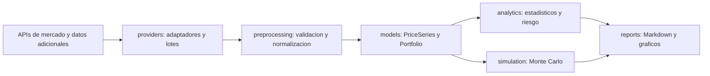

# Arquitectura prevista

Estructura inicial para los bloques del taller. La logica financiera esta pendiente.
Los adaptadores devolveran modelos comunes para desacoplar las APIs del analisis.
El [catalogo de fuentes](data-sources.md) define las 18 fuentes previstas,
su segmentacion funcional y la configuracion de acceso.

## Siguientes implementaciones

1. Definir dataclasses de series con metadatos y estadisticos automaticos.
2. Definir contratos por tipo de dato y desarrollar los adaptadores del catalogo
   por grupos: macro, fiscal, regulatory, market, specialized y datasets.
3. Incorporar acciones, indices y datos adicionales, por ejemplo fundamentales.
4. Implementar validacion, limpieza, alineacion y descarga de N series.
5. Implementar Portfolio con ponderaciones y metodo de simulacion Monte Carlo.
6. Incorporar `.report()` y `.plots_report()` y diagramar las clases reales.
