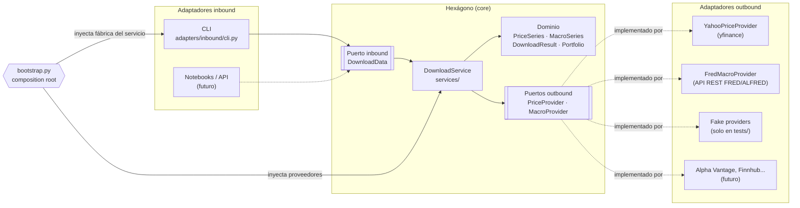

# Arquitectura del toolkit

El toolkit sigue una **arquitectura hexagonal (puertos y adaptadores)**, tal como se
describe en *Architecture Patterns with Python* (Percival & Gregory). La decisión y sus
alternativas están en [ADR 0001](adr/0001-arquitectura-hexagonal.md).

## Diagrama

## Capas

| Capa | Paquete | Responsabilidad | Puede importar |
|------|---------|-----------------|----------------|
| Dominio | `toolkit.domain` | Modelos (`PriceSeries`, `MacroSeries`, peticiones, `DownloadResult`), errores, `Portfolio`. Validación de esquema y estadísticos. | stdlib, `pandas`, `numpy` |
| Puertos | `toolkit.ports` | Contratos (`Protocol`): `DownloadData` (inbound), `PriceProvider` y `MacroProvider` (outbound). | `domain` |
| Servicios | `toolkit.services` | Casos de uso: `DownloadService` (descarga en lote, paralelismo, tolerancia a fallos). | `domain`, `ports` |
| Adaptadores | `toolkit.adapters` | Traducción con el exterior: CLI (inbound); Yahoo y FRED (outbound). Los fakes viven en `tests/`. | `domain`, `ports` y librerías externas; **nunca otro adaptador** |
| Composition root | `toolkit.bootstrap` | Carga `.env`, elige proveedores por nombre y los inyecta. Punto de entrada `toolkit`. | todo |

### Regla de dependencias

Las dependencias solo apuntan **hacia dentro**: adaptadores → puertos → dominio.
El dominio no sabe que existen Yahoo, FRED, HTTP ni la consola.

La regla se comprueba automáticamente en `tests/unit/test_architecture.py`, que recorre
los imports de cada módulo con `ast` y falla si alguna capa importa algo prohibido
(incluidos imports relativos y `yfinance`/`requests` en capas internas). También
comprueba que `src/` no contiene código de test: ni ficheros `test_*`/`fake*`/`conftest`
ni imports de `pytest`, `unittest` o `responses`.

La CLI tampoco importa `bootstrap` ni `DownloadService`. Recibe una *fábrica* que
devuelve un objeto que cumple `DownloadData`, y es `bootstrap.main` quien se la inyecta.
Por eso el entry point del paquete es `toolkit.bootstrap:main`.

## Flujo de una petición

`toolkit prices AAPL ^GSPC --start 2020-01-01`:

1. **`bootstrap.main`** carga `.env`, y la CLI (`cli.run`) parsea los argumentos.
2. La CLI llama a la fábrica inyectada →
   `build_download_service("yahoo", None)` → `DownloadService(YahooPriceProvider())`.
3. La CLI construye un `DownloadRequest` (dominio) y llama a
   `DownloadData.download_prices(request)` (puerto inbound).
4. **`DownloadService`** valida la petición (lista no vacía, `start <= end`) y normaliza
   y deduplica los tickers. Después lanza N llamadas `PriceProvider.fetch_prices` en un
   `ThreadPoolExecutor`.
5. **`YahooPriceProvider`** llama a `yfinance` con `auto_adjust=False` y normaliza el
   `DataFrame`: columnas en minúsculas, tz-naive, ordenado y sin duplicados. Construye
   la `PriceSeries`, que valida su esquema y calcula `mean_return`/`std_return` en
   `__post_init__`. Los errores de `yfinance` se traducen a
   `SeriesNotFoundError`/`ProviderError`.
6. El servicio recoge los resultados **en el orden de entrada**. Un fallo individual se
   guarda en `DownloadResult.errors` y no aborta el lote; solo `ConfigurationError` lo
   detiene, porque afecta a todas las series.
7. La CLI imprime el resumen, guarda CSV/Parquet si se indicó `--out` y devuelve el
   código de salida: 0 si hay al menos una serie OK, 1 si fallan todas y 2 ante errores
   de uso o configuración.

## Modelo de datos (el contrato)

- **`PriceSeries`**: `ticker`, `name`, `asset_type`, `source`, `currency`, `frequency` y
  `data`. `data` es un `DataFrame` con `DatetimeIndex` ordenado, único y tz-naive, y con
  las columnas `open, high, low, close, [adj_close], volume`.
  - Se calculan automáticamente `mean_return` y `std_return`: media y desviación típica
    muestral de los retornos simples por periodo, **sin anualizar**, sobre `adj_close`
    (o `close` si no existe).
  - Propiedades: `returns`, `log_returns`, `prices`, `start`, `end`, `n_obs`.
- **`MacroSeries`**: `series_id`, `name`, `source`, `units`, `frequency`, `data` (una
  `pd.Series` float con `NaN` para los huecos) y `vintage`. Calcula `mean` y `std`.
- **`DownloadResult[T]`**: `series` (en el orden de la petición) y `errors`, con las
  propiedades `ok`, `n_success`, `n_failed` y `all_failed`.
- **Errores**: `ToolkitError` es la base de `InvalidSeriesError`, `InvalidRequestError`,
  `ConfigurationError` y `ProviderError`; de este último deriva `SeriesNotFoundError`.

## FRED vs ALFRED

Sin `as_of`, FRED devuelve la **última revisión** de cada dato. Con `as_of`, el
adaptador envía `realtime_start = realtime_end = as_of` y obtiene los datos **tal como
se conocían ese día** (vintage). Así se evita el *look-ahead bias* en backtests, porque
muchas series macro (PIB, IPC, empleo) se revisan después de publicarse.

## Extender el sistema

- **Nueva fuente de datos**: un módulo en `adapters/outbound/` que cumpla `PriceProvider`
  o `MacroProvider`, más una línea en el registro de `bootstrap.py`. Ver el README.
- **Nuevo punto de entrada** (API, notebook): un adaptador inbound que dependa solo de
  `DownloadData` y reciba el servicio desde `bootstrap`.
- **Cartera / Monte Carlo / reportes**: en `domain/portfolio.py` y, si requieren I/O
  (gráficos, ficheros), en nuevos puertos y adaptadores.
